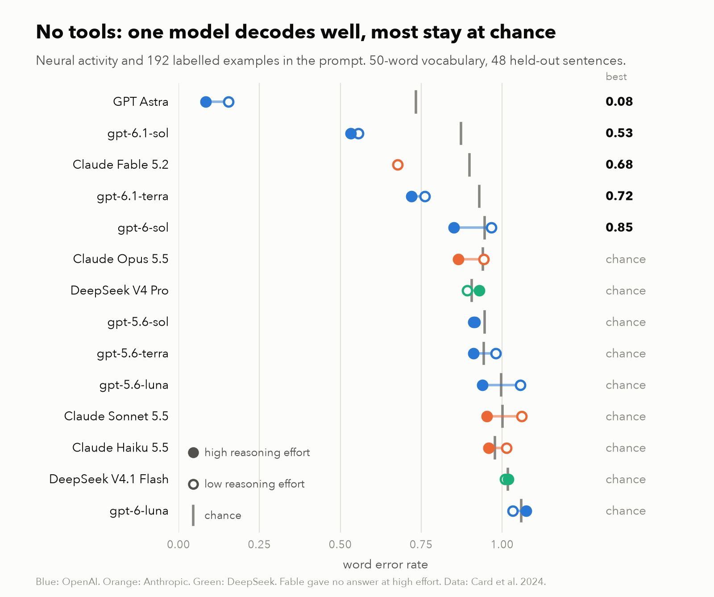
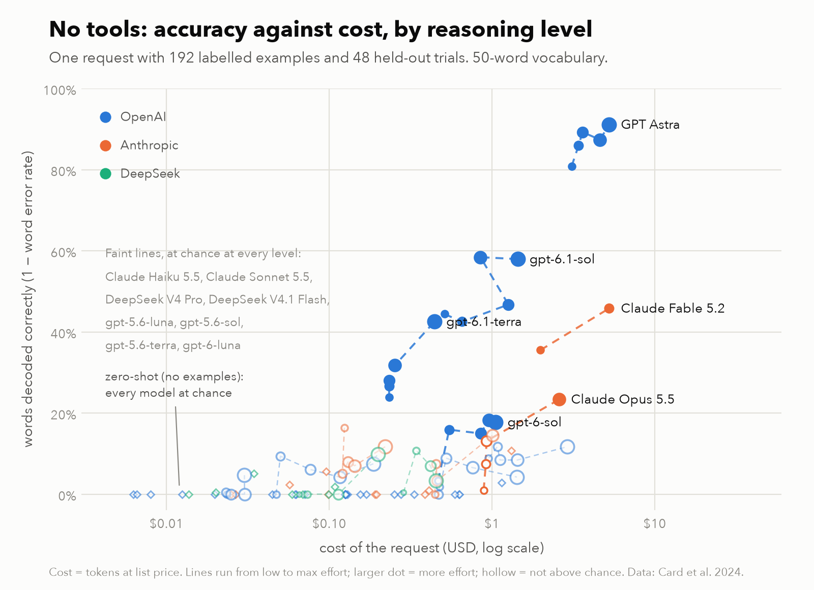
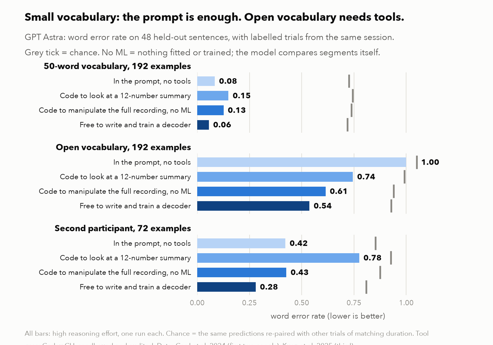
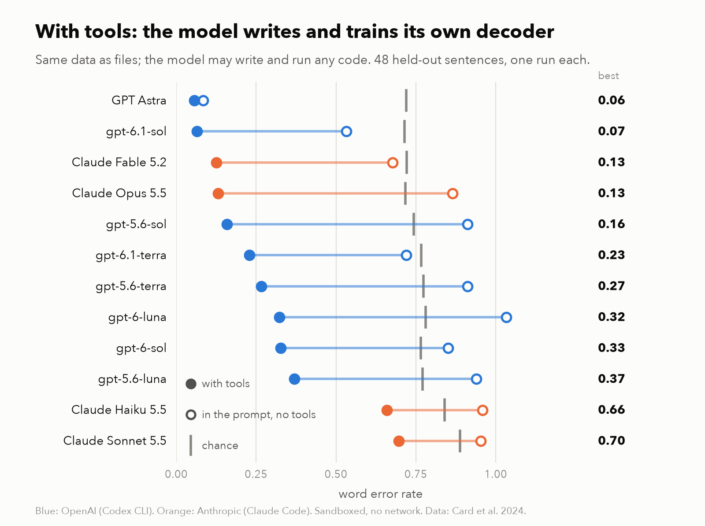

# IntracorticalBench

Can a frontier language model decode attempted speech from intracortical recordings when the
recordings are simply put in its prompt? No tools, no code execution, no fine-tuning: one request,
activity in, sentence out.


Short version of everything below: [`results/SUMMARY.md`](results/SUMMARY.md); the same numbers as data:
`results/summary.json`.

## What is tested

| Condition | Prompt |
|---|---|
| Zero-shot | Activity of 8 held-out trials, nothing else |
| In-context | 16, 64 or 192 labelled trials (activity + sentence) from the same session, then 8 held-out trials |
| Reasoning | Each of the above at low and at high reasoning effort |
| Activity withheld (control) | Same prompts, sentences and trial durations kept, activity removed |
| Planted code (positive control) | Same sentences and trial lengths, activity replaced by a synthetic word or letter code |
| Seven words (easy rung) | About 100 labelled single-word trials, then 42 held-out trials, 7-way |

Data, all public: T15 sentences from Card et al. 2024 (Brain-to-Text '25), first session with a
50-word vocabulary (`t15_small`) and an open-vocabulary session (`t15_open`); seven isolated
attempted words from Kunz et al. 2025 for participants T12, T15, T16, T17. Further sessions and participants,
including Willett et al. 2023 (T12 sentences), are under "Broader data".

**How activity is fed.** Threshold crossings and spike-band power are averaged into 160 ms frames,
reduced to 12 principal components (fit without labels), and each component is cut into deciles
written as a letter A-J, one frame per line. That is one token per value, about 900 tokens per
trial. Nothing supervised touches the features, so any decoding happens inside the model.

**What "chance" means.** The same predictions are re-paired with other trials' sentences, but only
among the 4 trials closest in duration (10,000 permutations). Trial duration reveals sentence
length without any decoding, so an unrestricted shuffle makes every model look significant. The
activity-withheld arm is the second control: it shows what guessing from the labelled sentences
and durations alone achieves.

## Results (48 held-out sentences per cell, one split)

`t15_small`, word error rate (duration-matched chance in brackets):

| Labelled trials | GPT Astra, low | GPT Astra, high | Fable 5.2, low | Fable 5.2, high | Opus 5.5, low | Opus 5.5, high |
|---|---|---|---|---|---|---|
| 0 | 1.24 (1.25) | 1.10 (1.10) | 1.23 (1.23) | 1.06 (1.07) | 1.07 (1.08) | 1.19 (1.20) |
| 16 | 0.64 (0.90) | 0.46 (0.84) | 0.80 (0.90) | 0.72 (0.93) | 0.92 (0.94) | 0.84 (0.93), 40 answered |
| 64 | 0.31 (0.78) | 0.20 (0.75) | 0.75 (0.87) | 0.65 (0.91), 40 answered | 0.93 (0.95) | 0.83 (0.93) |
| 192 | 0.15 (0.74) | 0.08 (0.73) | 0.68 (0.90) | no answer | 0.94 (0.96) | 0.86 (0.93) |

- **Zero-shot is at chance for every model** at both efforts (p = 0.25-0.47). There is no built-in
  decoder.
- **With labelled trials in the prompt, GPT Astra decodes**: WER 0.15 with 192 trials at low effort (56%
  of sentences exactly right) and 0.08 at high effort (79%), against 0.93 with activity withheld. A second random split of the same
  session gives 0.20 (54% exact; 0.98 withheld). Fable 5.2 is clearly above chance
  (p <= 0.0002 in every cell) but far weaker. Opus 5.5 beats the permutation null only at high
  effort and is not better than its own activity-withheld arm.
- **Reasoning helps where there is signal**: GPT Astra goes 0.64 -> 0.46 at 16 trials, 0.31 -> 0.20
  at 64 and 0.15 -> 0.08 at 192, at about 20x the output tokens; Fable 0.80 -> 0.72 at 16 trials and 0.75 -> 0.65 at 64. At 192 trials Fable at high effort used its whole 64k-token
  output limit on all six calls without answering.
- **Open vocabulary is close to chance**: best cells are Fable high effort (1.06 vs 1.09 at 64
  trials, p = 0.004; 1.05 vs 1.09 at 192, p = 0.007, 24 answered) and GPT Astra low effort (1.06 vs
  1.11 at 64 trials, p = 0.0001; 1.09 vs 1.11 at 192, p = 0.045, 32 answered). WER stays above 1 and
  no cell clearly beats its activity-withheld arm.
- **Seven words**: all three models reach 40-100% (chance 14%; 57-100% at high effort), about the same as nearest-centroid
  and LDA on the same input (64-95%).
- **Planted codes** (Fable only): WER 0.00-0.03 for a word code, 0.18-0.19 for a letter code with 64
  trials, so the prompt format can carry a sentence decoder.
- Reference decoder on the same input (small GRU-CTC over characters, trained from scratch, no
  language model): 0.65 at 64 trials, 0.52 at 192 on `t15_small`.

### Which models can do it

Twelve models on `t15_small` with 192 labelled trials in the prompt, no tools (WER at low / high
effort; chance is about 0.73 for GPT Astra and 0.86-1.07 for the rest).



| Model | Low | High | Above chance (p <= 0.01)? |
|---|---|---|---|
| GPT Astra (`gpt-6-astra`) | 0.15 | 0.08 | yes |
| `gpt-6.1-sol` | 0.56 | 0.53 | yes |
| Claude Fable 5.2 | 0.68 | no answer | yes |
| `gpt-6.1-terra` | 0.76 | 0.72 | yes |
| `gpt-6-sol` | 0.97 | 0.85 | high effort only |
| Claude Opus 5.5 | 0.94 | 0.86 | no (p = 0.017 at high effort) |
| `gpt-5.6-sol`, `gpt-5.6-terra`, `gpt-5.6-luna` | 0.91-1.06 | 0.91-0.94 | no |
| Claude Sonnet 5.5, Claude Haiku 5.5 | 1.01-1.06 | 0.95-0.96 | no |
| `gpt-6-luna` | 1.03 | 1.08 | no |

GPT Astra and the Claude models were called through their APIs (8 held-out sentences per request).
The other OpenAI models were run through the Codex CLI with tools forbidden and audited (all 48 in
one request); GPT Astra by that route scores 0.19 / 0.11, so the routes agree. Sonnet 5.5 and Haiku
5.5 are at chance at 16 and 64 trials too. Each cell is one run.

### Reasoning effort

Same test (192 labelled trials, no tools), every reasoning level each model offers, all 48 held-out
trials in one request. WER, with reasoning tokens in brackets; ° marks cells not above chance
(p > 0.01).



| Model | Off | Low | Medium | High | Extra high | Max |
|---|---|---|---|---|---|---|
| GPT Astra | | 0.19 [15k] | 0.14 [21k] | 0.11 [25k] | 0.13 [45k] | 0.09 [58k] |
| `gpt-6.1-sol` | | 0.56 [4k] | 0.57 [19k] | 0.53 [79k] | 0.42 [37k] | 0.42 [97k] |
| `gpt-6.1-terra` | | 0.76 [<0.1k] | 0.73 [<0.1k] | 0.72 [<0.1k] | 0.68 [4k] | 0.57 [42k] |
| `gpt-6-sol` | | 0.97° [0k] | 0.84 [8k] | 0.85 [39k] | 0.82 [48k] | 0.82 [58k] |
| Claude Fable 5.2 | | 0.64 [5k] | 0.54 [87k] | no answer | not run | not run |
| Claude Opus 5.5 | | 0.99° [0k] | 0.93° [1k] | 0.87° [2k] | 0.77 [85k] | no answer |
| `gpt-6-luna` | | 1.03° | 1.00° | 1.07° | 1.00° | 0.95° |
| `gpt-5.6-sol` | | 0.91° | 0.88° | 0.92° | 0.92° | 0.88° [98k] |
| `gpt-5.6-terra` | | 0.98° | 1.01° | 0.91° | 0.93° | 0.96° [79k] |
| `gpt-5.6-luna` | | 1.06° | 0.91° | 0.94° | 0.96° | 0.93° [116k] |
| Claude Sonnet 5.5 | | 1.04° | 0.93° | 0.97° | 0.86° [56k] | not run |
| Claude Haiku 5.5 | | 0.84° | 0.95° | 0.92° | 0.93° | 0.88° [44k] |
| DeepSeek V4.1 Flash | 1.09° | 1.01° | | 1.02° [41k] | | 0.90° [112k] |
| DeepSeek V4 Pro | 1.00° | 0.89° | | 0.93° [33k] | | 0.97° [42k] |

- More reasoning helps the models that can already do it (GPT Astra 0.19 -> 0.09, `gpt-6.1-sol`
  0.56 -> 0.42, `gpt-6.1-terra` 0.76 -> 0.57, Opus 0.99 -> 0.77) and does nothing for the rest:
  100k reasoning tokens leave `gpt-5.6-*` and DeepSeek at chance.
- Reasoning is not required. `gpt-6.1-terra` scores 0.72-0.76 with under 100 reasoning tokens, and
  GPT Astra's 0.19 costs 15k tokens for 48 sentences.
- Fable 5.2 at high effort and Opus 5.5 at max ran into the 128k-token output limit while still
  thinking, so they have no answer.
- OpenAI models ran through the Codex CLI and Claude models through Claude Code, both with tools
  switched off; DeepSeek through its API (`icbench/oneshot.py`).

### Zero-shot, every model

No labelled trials, only the 48 held-out recordings: 56 runs over the 14 models from reasoning off
to max, including open vocabulary and image input. None is above chance: no run has p <= 0.01, two
have p <= 0.05 (about three expected by luck), the mean gap to chance is 0.002 WER, and no sentence
was ever decoded exactly. GPT Astra at max effort scores 0.97 against a chance of 0.99.

### How the models do it

Reasoning is hidden, so this is indirect evidence.

- **Reasoning summaries** (Codex, GPT Astra): the headings read as segmenting a trial into words,
  comparing stretches with named labelled trials, and telling look-alike words apart.
- **Asked afterwards** in the same conversation: GPT Astra describes "manual template matching with
  language-based guessing" and cites labelled trials and frame ranges that check out against the
  data. Sonnet 5.5 says nothing came from the frames, only from trial duration. Fable 5.2's
  follow-up was blocked by its safeguards.
- **Behaviour**: GPT Astra's word accuracy rises with how often the word occurs in the labelled
  trials (56% for the rarest words, 95% for the commonest), and its confusions are the ones trained
  decoders make on this session (do/tell, they/you, not/that).

So it is pattern matching against the examples in the prompt, done by the model itself.

**Giving the method to the other models.** GPT Astra's description, turned into six general steps
with no word-specific cues, was added to the prompt (WER without -> with):

| Model | Effort | Without | With the method |
|---|---|---|---|
| `gpt-6.1-sol` | high | 0.53 | 0.21 |
| GPT Astra | low | 0.19 | 0.12 |
| `gpt-6.1-terra` | high | 0.72 | 0.64 |
| `gpt-6-sol` | high | 0.85 | 0.80 |
| Claude Opus 5.5 | high | 0.87° | 0.82 |
| `gpt-5.6-sol`, `-terra`, `-luna` | high | 0.91-0.94° | 0.91-0.95° |
| `gpt-6-luna` | high | 1.07° | 1.02° |
| Claude Sonnet 5.5, Haiku 5.5 | high | 0.97°, 0.92° | 0.91°, 0.92° |
| DeepSeek V4.1 Flash, V4 Pro | high | 1.02°, 0.93° | 0.90°, 0.93° |
| Claude Fable 5.2 | medium | 0.54 | no answer |

Only `gpt-6.1-sol` (50% of sentences exact, with fewer reasoning tokens than before) and GPT Astra
improve by more than the noise of a 48-sentence test. Opus 5.5 goes from marginal (p = 0.02) to
clearly above chance (p = 0.0003) while thinking 40 times longer (2k -> 82k tokens). The seven
models that were flat at chance stay there, so knowing the method is not what they lack. Fable hit the output limit before answering; the
answer it gave after being allowed to continue scores 0.59 and is not counted.

### With tools (Codex harness)

Same 192 labelled and 48 held-out trials, same 12-component input, but as files in a folder where
GPT Astra (high effort, Codex CLI, sandboxed, no network) may write and run code for about 20
minutes. This asks whether the agent can build a decoder, not whether the model can decode in its
head.

| Session | In the prompt, no tools | With tools |
|---|---|---|
| `t15_small` | 0.15 low effort; 0.08 high effort | **0.06** (75% of sentences exact) |
| `t15_open` | 1.09 low effort (chance 1.11) | **0.54** (chance 0.93; 8% exact) |

It built word-level HMM / neural acoustic models with a bigram language model for `t15_small`, and
word segmentation plus word templates for `t15_open`, then hand-edited 15 open-vocabulary
predictions for plausibility (the model rescoring its own candidate lists: WER 0.64 before the
edits, 0.54 after; all four exactly-right sentences and 11 of the 12 recovered unseen words come
from the edits). On `t15_open` it recovers 74% of the words that occur in the labelled
sentences and 11% of those that never do, so it is still a seen-word decoder. Every command it ran
stayed inside the task folder (`icbench/agentic.py` audits the log).
The result also shows the 12-component input does carry open-vocabulary information that the
models did not use in context and that the GRU-CTC reference (0.85) missed.

### In between: code to handle the data, but no machine learning

GPT Astra in Codex again, but told that it is the decoder. Code may transform and summarise the
data (numpy only); nothing may be fitted or trained to predict words, no program may assign words
to test trials, and it must type the sentences itself. Two versions:

- **Summary only** (`--rules lite`): the files hold the same 12-component summary the prompt uses;
  code may print trials and compare segments it picks by hand.
- **Full recording** (`--rules manipulate --full-recording`): the files also hold every electrode
  and both features at the original 20 ms steps; any label-free manipulation is allowed.

| Dataset | In the prompt (API) | Summary only | Full recording | Full tools (trains a decoder) |
|---|---|---|---|---|
| `t15_small`, 192 trials | 0.15 low; 0.08 high | 0.15 | 0.13 (67% exact) | 0.06 |
| `t15_open`, 192 trials | 1.09 low; 1.00 high (via Codex, no tools) | 0.74 | 0.61 | 0.54 |
| `t16_small`, 72 trials | 0.59 low; 0.42 high (via Codex, no tools) | 0.78 | 0.43 | 0.28 |



With the full recording, the no-machine-learning condition beats the summary-only version on all
three datasets. Against plain in-prompt decoding at the same (high) effort it is no better on the
two 50-word sets (0.13 vs 0.08, 0.43 vs 0.42); its clear gain is on open vocabulary, where the
prompt alone stays at WER 1.0 even at high effort. (The figure uses high effort for every bar.) The command
logs show what it did: printed stretches of the recording, chose word boundaries and reference
examples by hand, removed baselines, restricted to particular arrays or to spike-band power, and
printed tables of correlations between its chosen test segments and its chosen labelled segments.
That is template matching carried out by the model: no parameters are learned and no code picks a
word, but whether it counts as "no machine learning" is a judgement call. On `t15_open` it found
118 of 190 words that occur in the labelled sentences and 9 of 108 that do not (summary only: 91
and 4; trained decoder: 140 and 12).

Giving the model more in the prompt did not help in the same way: through Codex without tools, 24
components or 26 levels in place of 12 components and 10 levels made GPT Astra worse at low effort
(WER 0.37 and 0.24 against 0.19) and at high effort on `t16_small` (0.53 with 24 components, 0.59
with 40, against 0.42), although a classical decoder improves on the richer input
(`icbench/lossiness.py`: 0.54 -> 0.34 with 24 components).

### Every model with tools

All twelve models on `t15_small` (192 labelled trials), free to write and train a decoder, high
effort, one run each. OpenAI models ran in the Codex CLI, Claude models in Claude Code.



| Model | In the prompt (best effort) | With tools |
|---|---|---|
| GPT Astra | 0.08 | 0.06 |
| `gpt-6.1-sol` | 0.53 | 0.07 |
| Claude Fable 5.2 | 0.68 | 0.13 |
| Claude Opus 5.5 | 0.86 | 0.13 |
| `gpt-5.6-sol` | 0.91 | 0.16 |
| `gpt-6.1-terra` | 0.72 | 0.23 |
| `gpt-5.6-terra` | 0.91 | 0.27 |
| `gpt-6-luna` | 1.03 | 0.32 |
| `gpt-6-sol` | 0.85 | 0.33 |
| `gpt-5.6-luna` | 0.94 | 0.37 |
| Claude Haiku 5.5 | 0.96 | 0.66 |
| Claude Sonnet 5.5 | 0.95 | 0.70 |

Every model beats chance with tools (p = 0.0001), including the seven that are at chance in the
prompt: writing a decoder is an engineering task, and decoding in the prompt is not. Most trained a
CTC network or a word-level HMM with a small language model from the training sentences; Sonnet and
Haiku fitted per-word logistic regressions on time-averaged features, which is why they trail.
Audit notes: three Codex runs wrote scratch scripts to `/tmp`, and `gpt-5.6-sol` read Codex's own
bundled skill files; none read data or other runs' folders.

### Claude Fable 5.2 in an agent harness (Claude Code)

The same task folders and rules, run headless in Claude Code at high effort, sandboxed (verified
by a probe: no network, no reads or writes outside the task folder, no access to other runs).
One run per cell; WER, with GPT Astra's Codex result for the same cell in brackets.

| Dataset | Fable in the prompt | Full recording, no ML | Trains a decoder |
|---|---|---|---|
| `t15_small`, 192 trials | 0.68 low | 0.03 (Astra 0.13) | 0.13 (Astra 0.06) |
| `t15_open`, 192 trials | 1.05-1.21 | 0.49 (Astra 0.61) | 0.31 (Astra 0.54) |
| `t16_small`, 72 trials | 0.79 high | 0.11 (Astra 0.43) | 0.28 (Astra 0.28) |

Fable is weak in the prompt but strong once it can run code. Its trained open-vocabulary decoder
(word-count CTC, phoneme CTC with hand-written pronunciations, then sentences chosen by the model
from candidate lists) recovers 40 of 108 words never seen in the labelled sentences (Astra: 12).

The "no ML" numbers are not like-for-like with Astra's. Under the same written rules Fable went
further: unsupervised PCA and whitening of the full recording, automatic cuts of labelled trials at
envelope valleys, and for every test segment a *sorted* list of its correlation with every labelled
word segment. It read those lists and typed the sentences, and said so in its notes, but that is a
nearest-neighbour lookup in all but the final choice, which the rules were meant to exclude. On
`t16_small` it also guessed two unseen words from its memory of the usual 50-word set.

### Broader data

More participants, inner speech, other days, a cross-day split and image input. "With tools" is one
Codex run per dataset (GPT Astra, high effort); "in the prompt" is text input at low effort unless noted. WER, duration-matched chance in brackets.

| Dataset | Labelled trials | With tools | Fable in the prompt | GPT Astra in the prompt |
|---|---|---|---|---|
| T16, attempted, 50-word (`t16_small`) | 72 | 0.28 (0.81) | 0.87 low, 0.79 high (0.91-0.92) | 0.59 (0.91) |
| T12 inner speech, 50-word (`t12_inner`) | 152 | 0.47 (0.88) | 0.88 low (0.97) | 0.72 (0.93) |
| T15 inner speech, 50-word (`t15_inner`) | 152 | 0.74 (0.87) | 0.95 low (1.02) | not run |
| T15 April 2024, ~100 words (`t15_2024`) | 192 | 0.11 (0.74) | 0.86 low (0.95) | not run |
| T15 day 2, open vocabulary (`t15_day2`) | 192 | 0.49 (0.91) | not run | not run |
| T15 January 2025, open vocabulary (`t15_2025`) | 115 | 0.61 (0.95) | not run | not run |
| T12 Willett, open vocabulary (`t12_open`) | 192 | 0.83 (0.99) | not run | not run |
| Cross-day: labelled 1 Sept, test 3 Sept 2023 (`t15_sep01>t15_open`) | 192 | 0.39 (0.88) | not run | not run |

Every cell is above chance (p <= 0.006). With tools the agent builds a usable decoder for a second
participant and for later days, a weak one for inner speech, and barely anything for T12's faster
open-vocabulary speech. The cross-day run scored better than the same-day run on the same 48 test
sentences (0.39 vs 0.54) because the agent chose a different method (character and phoneme CTC,
then fluent rewrites), so single tools runs vary a lot with the approach taken. In the prompt,
Fable's effect is real but small everywhere.

Image input on `t15_small` (one heat map per trial, about a seventh of the tokens) is worse than
text: Fable 0.83 / 0.76 at 64 / 192 trials low effort and 0.73 at 64 high (text: 0.75 / 0.68 / 0.65).
GPT Astra with images attached through Codex, no tools (audited), stays at 0.81-0.87 for 16-192
trials at either effort, against 0.64-0.09 with text through the API; zero-shot is at chance. Codex
may downscale attached images, which this test does not control.

Full tables: [`results/report.md`](results/report.md); every cell's predictions, references and
scores are in `results/cells/`. Regenerate with `uv run python -m icbench.report`; figures with
`uv run python -m icbench.social`.

## Limits

- One session per condition, one random split, 48 queries; held-out trials are interleaved in time
  with the labelled ones, the most favourable case. Nothing here tests transfer across days.
- In `t15_small` every held-out word also occurs in the labelled sentences; in `t15_open` 36% of
  held-out words never do.
- Unanswered trials are not scored: Opus 5.5 had 28 calls declined by its safety classifier
  (category "cyber"), Fable 5.2 had 13 calls end at the output limit, one GPT Astra call was cut off.
- The Claude models were told a 40k-token budget per call after the first high-effort cell ran to
  the limit; cells finished before that change ran without it.
- GPT Astra's open-vocabulary cell at 192 trials covers 32 of 48 sentences (two calls hit a rate
  limit).
- The broader-data tools results are one agent run each, and the agent picks its own method, so
  they carry run-to-run variance that is not measured here.
- Not run: GPT Astra in the prompt on the broader datasets or at high effort on open vocabulary
  (spending limit reached), in-prompt tests on the new open-vocabulary and cross-day sets.

## Running

```
uv sync
# keys in .env: ANTHROPIC_API_KEY, OPENAI_API_KEY (DEEPSEEK_API_KEY for icbench.oneshot)
uv run python -m icbench.run sentences --dataset t15_small --model fable --k 0 16 64 192 --effort low high
uv run python -m icbench.run sentences --dataset t15_small --model fable --k 0 16 64 192 --effort low high --fmt none
uv run python -m icbench.run words --dataset t12 t15 t16 t17 --model opus --k 1 --effort low high --batch 50
uv run python -m icbench.baselines && uv run python -m icbench.report && uv run python -m icbench.figure
uv run python -m icbench.summary   # results/summary.json, the numbers behind results/SUMMARY.md
```

Every call is cached in `runs/cache`, so re-running a finished cell costs nothing. Spending is
tracked in `runs/ledger.json` and capped per provider (`ICB_CAP_ANTHROPIC`, `ICB_CAP_OPENAI`); a
file `runs/FROZEN_<provider>` pauses a provider entirely.
`ICB_OFFLINE=1` re-scores from the cache without calling anything. The tool-using variant is
`python -m icbench.agentic make|score` (see its docstring). T15 sessions are read from
`data/t15/<session>/data_train.hdf5`; everything else is read from the folder named by
`ICB_RAW_DATA` in `.env` (default `data/raw`), laid out as in `icbench/data.py`.

## Data

No neural data is included here. All of it is public and has to be downloaded from the authors:

- Card et al. 2024, "An accurate and rapidly calibrating speech neuroprosthesis", NEJM
  (participant T15; Brain-to-Text '25 release). Dryad, doi:10.5061/dryad.dncjsxm85
- Kunz et al. 2025, "Inner speech in motor cortex and implications for speech neuroprostheses",
  Cell (T12, T15, T16, T17: seven-word task, 50-word attempted and inner-speech sentences). Dryad,
  doi:10.5061/dryad.gf1vhhn1j
- Willett et al. 2023, "A high-performance speech neuroprosthesis", Nature (participant T12). Dryad,
  doi:10.5061/dryad.x69p8czpq

The files in `results/cells/` contain the cued sentences of the held-out trials next to each
model's predictions, and nothing else from these datasets.

## Licence

Code: MIT (see `LICENSE`). The datasets belong to their authors and are not redistributed here.
