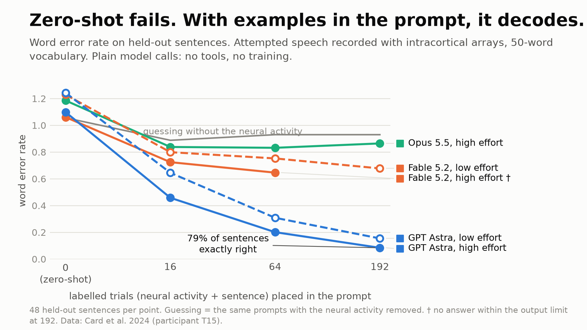

# IntracorticalBench

Can a frontier language model decode attempted speech from intracortical recordings when the
recordings are simply put in its prompt? No tools, no code execution, no fine-tuning: one request,
activity in, sentence out.



## What is tested

| Condition | Prompt |
|---|---|
| Zero-shot | Activity of 8 held-out trials, nothing else |
| In-context | 16, 64 or 192 labelled trials (activity + sentence) from the same session, then 8 held-out trials |
| Reasoning | Each of the above at low and at high reasoning effort |
| Activity withheld (control) | Same prompts, sentences and trial durations kept, activity removed |
| Planted code (positive control) | Same sentences and trial lengths, activity replaced by a synthetic word or letter code |
| Seven words (easy rung) | About 100 labelled single-word trials, then 42 held-out trials, 7-way |

Data, all public: T15 sentences from Card et al. 2024 (Brain-to-Text '25), first session with a
50-word vocabulary (`t15_small`) and an open-vocabulary session (`t15_open`); seven isolated
attempted words from Kunz et al. 2025 for participants T12, T15, T16, T17. A loader for Willett et
al. 2023 (T12 sentences) exists but has not been run.

**How activity is fed.** Threshold crossings and spike-band power are averaged into 160 ms frames,
reduced to 12 principal components (fit without labels), and each component is cut into deciles
written as a letter A-J, one frame per line. That is one token per value, about 900 tokens per
trial. Nothing supervised touches the features, so any decoding happens inside the model.

**What "chance" means.** The same predictions are re-paired with other trials' sentences, but only
among the 4 trials closest in duration (10,000 permutations). Trial duration reveals sentence
length without any decoding, so an unrestricted shuffle makes every model look significant. The
activity-withheld arm is the second control: it shows what guessing from the labelled sentences
and durations alone achieves.

## Results (48 held-out sentences per cell, one split)

`t15_small`, word error rate (duration-matched chance in brackets):

| Labelled trials | GPT Astra, low | GPT Astra, high | Fable 5.2, low | Fable 5.2, high | Opus 5.5, low | Opus 5.5, high |
|---|---|---|---|---|---|---|
| 0 | 1.24 (1.25) | 1.10 (1.10) | 1.23 (1.23) | 1.06 (1.07) | 1.07 (1.08) | 1.19 (1.20) |
| 16 | 0.64 (0.90) | 0.41 (0.82), 40 answered | 0.80 (0.90) | 0.72 (0.93) | 0.92 (0.94) | 0.84 (0.93), 40 answered |
| 64 | 0.31 (0.78) | 0.16 (0.74), first 24 only | 0.75 (0.87) | 0.65 (0.91), 40 answered | 0.93 (0.95) | 0.83 (0.93) |
| 192 | 0.15 (0.74) | 0.09 (0.73), first 24 only | 0.68 (0.90) | no answer | 0.94 (0.96) | 0.86 (0.93) |

- **Zero-shot is at chance for every model** at both efforts (p = 0.25-0.47). There is no built-in
  decoder.
- **With labelled trials in the prompt, GPT Astra decodes**: WER 0.15 with 192 trials, 56% of
  sentences exactly right, against 0.93 with activity withheld. A second random split of the same
  session gives 0.20 (54% exact; 0.98 withheld). Fable 5.2 is clearly above chance
  (p <= 0.0002 in every cell) but far weaker. Opus 5.5 beats the permutation null only at high
  effort and is not better than its own activity-withheld arm.
- **Reasoning helps where there is signal**: on identical sentences GPT Astra goes 0.61 -> 0.41 at
  16 trials, 0.32 -> 0.16 at 64 and 0.14 -> 0.09 at 192 (83% of sentences exact), at about 20x the
  output tokens; Fable 0.80 -> 0.72 at 16 trials and 0.75 -> 0.65 at 64. At 192 trials Fable at high effort used its whole 64k-token
  output limit on all six calls without answering.
- **Open vocabulary is close to chance**: best cells are Fable high effort (1.06 vs 1.09 at 64
  trials, p = 0.004; 1.05 vs 1.09 at 192, p = 0.007, 24 answered) and GPT Astra low effort (1.06 vs
  1.11 at 64 trials, p = 0.0001; 1.09 vs 1.11 at 192, p = 0.045, 32 answered). WER stays above 1 and
  no cell clearly beats its activity-withheld arm.
- **Seven words**: all three models reach 40-100% (chance 14%; 57-100% at high effort), about the same as nearest-centroid
  and LDA on the same input (64-95%).
- **Planted codes** (Fable only): WER 0.00-0.03 for a word code, 0.18-0.19 for a letter code with 64
  trials, so the prompt format can carry a sentence decoder.
- Reference decoder on the same input (small GRU-CTC over characters, trained from scratch, no
  language model): 0.65 at 64 trials, 0.52 at 192 on `t15_small`.

### With tools (Codex harness)

Same 192 labelled and 48 held-out trials, same 12-component input, but as files in a folder where
GPT Astra (high effort, Codex CLI, sandboxed, no network) may write and run code for about 20
minutes. This asks whether the agent can build a decoder, not whether the model can decode in its
head.

| Session | In the prompt, no tools | With tools |
|---|---|---|
| `t15_small` | 0.15 low effort; 0.09 high effort (first 24) | **0.06** (75% of sentences exact) |
| `t15_open` | 1.09 low effort (chance 1.11) | **0.54** (chance 0.93; 8% exact) |

It built word-level HMM / neural acoustic models with a bigram language model for `t15_small`, and
word segmentation plus word templates for `t15_open`, then hand-edited 15 open-vocabulary
predictions for plausibility (the model rescoring its own candidate lists: WER 0.64 before the
edits, 0.54 after; all four exactly-right sentences and 11 of the 12 recovered unseen words come
from the edits). On `t15_open` it recovers 74% of the words that occur in the labelled
sentences and 11% of those that never do, so it is still a seen-word decoder. Every command it ran
stayed inside the task folder (`icbench/agentic.py` audits the log).
The result also shows the 12-component input does carry open-vocabulary information that the
models did not use in context and that the GRU-CTC reference (0.85) missed.

### In between: code as a viewer and calculator only

GPT Astra in Codex again, but told that it is the decoder: code may only print trials and compute
simple descriptive numbers on segments it picks by hand (numpy only, no model fitting, no script
that outputs words), and it must type the sentences itself (`--rules lite`). The command logs show
it kept to this: it printed compressed trials, chose word boundaries by eye, compared hand-picked
segment means, and wrote the predictions through its file-edit tool.

| Dataset | In the prompt (API) | Viewer/calculator only | Full tools |
|---|---|---|---|
| `t15_small`, 192 trials | 0.15 low; 0.09 high (first 24) | 0.15 (58% exact; 0.15 on the first 24) | 0.06 |
| `t15_open`, 192 trials | 1.09 low (chance) | 0.74 (chance 0.99) | 0.54 |
| `t16_small`, 72 trials | not run (Fable: 0.79-0.87) | 0.78 (chance 0.93) | 0.28 |

Being able to look at the data selectively does not beat plain in-prompt decoding on the easy
session, but it lifts open vocabulary from chance to 0.74. The large gains come from fitted models.

### Broader data

More participants, inner speech, other days, a cross-day split and image input. "With tools" is one
Codex run per dataset (GPT Astra, high effort); "in the prompt" is Fable 5.2, text input, the only
in-prompt model run here (GPT Astra's API was paused). WER, duration-matched chance in brackets.

| Dataset | Labelled trials | With tools | Fable in the prompt |
|---|---|---|---|
| T16, attempted, 50-word (`t16_small`) | 72 | 0.28 (0.81) | 0.87 low, 0.79 high (0.91-0.92) |
| T12 inner speech, 50-word (`t12_inner`) | 152 | 0.47 (0.88) | 0.88 low (0.97) |
| T15 inner speech, 50-word (`t15_inner`) | 152 | 0.74 (0.87) | 0.95 low (1.02) |
| T15 April 2024, ~100 words (`t15_2024`) | 192 | 0.11 (0.74) | 0.86 low (0.95) |
| T15 day 2, open vocabulary (`t15_day2`) | 192 | 0.49 (0.91) | not run |
| T15 January 2025, open vocabulary (`t15_2025`) | 115 | 0.61 (0.95) | not run |
| T12 Willett, open vocabulary (`t12_open`) | 192 | 0.83 (0.99) | not run |
| Cross-day: labelled 1 Sept, test 3 Sept 2023 (`t15_sep01>t15_open`) | 192 | 0.39 (0.88) | not run |

Every cell is above chance (p <= 0.006). With tools the agent builds a usable decoder for a second
participant and for later days, a weak one for inner speech, and barely anything for T12's faster
open-vocabulary speech. The cross-day run scored better than the same-day run on the same 48 test
sentences (0.39 vs 0.54) because the agent chose a different method (character and phoneme CTC,
then fluent rewrites), so single tools runs vary a lot with the approach taken. In the prompt,
Fable's effect is real but small everywhere.

Image input on `t15_small` (one heat map per trial, about a seventh of the tokens) is worse than
text: Fable 0.83 / 0.76 at 64 / 192 trials low effort and 0.73 at 64 high (text: 0.75 / 0.68 / 0.65).
GPT Astra with images attached through Codex, no tools (audited), stays at 0.81-0.87 for 16-192
trials at either effort, against 0.64-0.09 with text through the API; zero-shot is at chance. Codex
may downscale attached images, which this test does not control.

Full tables: [`results/report.md`](results/report.md); every cell's predictions, references and
scores are in `results/cells/`. Regenerate with `uv run python -m icbench.report`; figures with
`uv run python -m icbench.social`.

## Limits

- One session per condition, one random split, 48 queries; held-out trials are interleaved in time
  with the labelled ones, the most favourable case. Nothing here tests transfer across days.
- In `t15_small` every held-out word also occurs in the labelled sentences; in `t15_open` 36% of
  held-out words never do.
- Unanswered trials are not scored: Opus 5.5 had 28 calls declined by its safety classifier
  (category "cyber"), Fable 5.2 had 13 calls end at the output limit, one GPT Astra call was cut off.
- The Claude models were told a 40k-token budget per call after the first high-effort cell ran to
  the limit; cells finished before that change ran without it.
- GPT Astra's high-effort cells at 64 and 192 trials cover only the first 24 held-out sentences, and
  its open-vocabulary cell at 192 trials 32 of 48 (two calls hit a rate limit).
- The broader-data tools results are one agent run each, and the agent picks its own method, so
  they carry run-to-run variance that is not measured here.
- Not run: GPT Astra in the prompt on the broader datasets or at high effort on open vocabulary
  (API paused), in-prompt tests on the new open-vocabulary and cross-day sets.

## Running

```
uv sync
# keys in .env: ANTHROPIC_API_KEY, OPENAI_API_KEY
uv run python -m icbench.run sentences --dataset t15_small --model fable --k 0 16 64 192 --effort low high
uv run python -m icbench.run sentences --dataset t15_small --model fable --k 0 16 64 192 --effort low high --fmt none
uv run python -m icbench.run words --dataset t12 t15 t16 t17 --model opus --k 1 --effort low high --batch 50
uv run python -m icbench.baselines && uv run python -m icbench.report && uv run python -m icbench.figure
```

Every call is cached in `runs/cache`, so re-running a finished cell costs nothing. Spending is
tracked in `runs/ledger.json` and capped per provider (`ICB_CAP_ANTHROPIC`, `ICB_CAP_OPENAI`); a
file `runs/FROZEN_<provider>` pauses a provider entirely.
`ICB_OFFLINE=1` re-scores from the cache without calling anything. The tool-using variant is
`python -m icbench.agentic make|score` (see its docstring). T15 sessions are read from
`data/t15/<session>/data_train.hdf5`; everything else is read from the folder named by
`ICB_RAW_DATA` in `.env` (default `data/raw`), laid out as in `icbench/data.py`.

## Data

No neural data is included here. All of it is public and has to be downloaded from the authors:

- Card et al. 2024, "An accurate and rapidly calibrating speech neuroprosthesis", NEJM
  (participant T15; Brain-to-Text '25 release). Dryad, doi:10.5061/dryad.dncjsxm85
- Kunz et al. 2025, "Inner speech in motor cortex and implications for speech neuroprostheses",
  Cell (T12, T15, T16, T17: seven-word task, 50-word attempted and inner-speech sentences). Dryad,
  doi:10.5061/dryad.gf1vhhn1j
- Willett et al. 2023, "A high-performance speech neuroprosthesis", Nature (participant T12). Dryad,
  doi:10.5061/dryad.x69p8czpq

The files in `results/cells/` contain the cued sentences of the held-out trials next to each
model's predictions, and nothing else from these datasets.

## Licence

Code: MIT (see `LICENSE`). The datasets belong to their authors and are not redistributed here.
